# flakewatch

[](https://github.com/baggy2797/flakewatch/actions/workflows/ci.yml)

Find flaky tests across many CI runs from the JUnit XML you already produce, work out *why* each one is probably flaky, and keep them from blocking merges: with a PR comment, a JSON report and a quarantine file whose entries expire.

It is a Python CLI (`flakewatch`), a Docker image and a composite GitHub Action. It understands pytest, TestNG/Surefire (including `flakyFailure`/`rerunFailure` retry elements) and jest-junit output, and it has a rule set aimed at **Selenium** failures (`StaleElementReferenceException`, `TimeoutException`, `NoSuchElementException`, `ElementClickInterceptedException`, ...), because "which flaky tests are really stale-element races" is the question UI-test owners ask first.

> **Status: alpha, portfolio-grade.** The unit tests, lint, types and a 3.10 / 3.12 / 3.13 run pass locally. The Docker image, the GitHub workflows, live LLM calls and live PR commenting have **not** been executed yet; see [What is and is not verified](#what-is-and-is-not-verified). The benchmark corpus is **synthetic**; read [the benchmark section](#benchmark-synthetic-data-read-this-before-quoting-a-number) before quoting any number from this README.

## How it fits together

```mermaid
flowchart LR
    subgraph CI["CI run N"]
      T["pytest / TestNG / jest\n(JUnit XML)"]
    end
    T -->|"flakewatch analyze"| P["parser\n(defusedxml, merges retries/shards)"]
    P --> S[("SQLite history\n.flakewatch/history.db")]
    S --> A["analyzer\nflip rate, pass-after-retry,\nsame-commit pass+fail,\nfailure-signature clusters"]
    A --> R["report.json"]
    R -->|"flakewatch classify"| C{"engine"}
    C --> H["heuristic rules\n(Selenium-aware)"]
    C --> L["LLM (Anthropic)\nredacted, JSON-validated"]
    C --> M["mock-llm\n(offline stand-in)"]
    L -. "any failure" .-> H
    H --> R2["report.json + classification"]
    L --> R2
    M --> R2
    R2 -->|"flakewatch quarantine"| Q["quarantine.json\n(TTL per entry)"]
    R2 -->|"flakewatch comment"| MD["Markdown: PR comment\n+ job summary"]
    S -. "actions/cache or artifact" .-> CI
```



## Quickstart

```bash
pip install flakewatch            # not on PyPI yet; use `pip install .` from a clone
flakewatch --help
```

Try it on the bundled **synthetic** sample (12 runs of a made-up suite):

```bash
pip install .
examples/ingest_sample.sh                 # ingests run-000..run-011, writes .flakewatch/out/{report.json,report.md,comment.md,quarantine.json}
cat .flakewatch/out/comment.md
```

Or without installing Python: `docker compose up --build` (see [Docker](#docker)).

### The four commands

```bash
# 1. Ingest this run's XML into the history DB and analyse the last 50 runs.
flakewatch analyze reports/ --db .flakewatch/history.db \
    --json-out report.json --md-out report.md --summary        # --summary appends to $GITHUB_STEP_SUMMARY

# 2. (Re)classify root causes. engines: heuristic | mock-llm | llm | none
flakewatch classify report.json --engine heuristic
flakewatch classify report.json --mock-llm                      # same as --engine mock-llm, no network
ANTHROPIC_API_KEY=... flakewatch classify report.json --engine llm   # falls back to heuristic per test on any error

# 3. Quarantine still-flaky tests for 14 days; expired entries are dropped.
flakewatch quarantine report.json --file .flakewatch/quarantine.json --ttl-days 14 --emit surefire
#    --emit pytest   -> --deselect=pkg/mod.py::Class::test ...
#    --emit surefire -> '!Class#method,...'   (use as -Dtest='...')
#    --emit ids      -> one test id per line (feed to jest --testPathIgnorePatterns, etc.)

# 4. Render Markdown; optionally write the job summary and post/update one sticky PR comment.
flakewatch comment report.json --quarantine-file .flakewatch/quarantine.json --summary --post
```

`analyze --fail-on-flaky` exits 1 when a flaky test is **not** in an active quarantine entry, so you can gate merges on *new* flakes only.

`run_id` defaults to `$GITHUB_RUN_ID-$GITHUB_RUN_ATTEMPT` (otherwise a hash of the XML), `--commit` to `$GITHUB_SHA`. Re-ingesting a `run_id` replaces it, so re-running a job is idempotent.

### Example output (excerpt, from the golden test)

```
**3 flaky** · 1 consistently failing · 1 stable · 0 with too little history — 5 run(s) analysed, flaky threshold 0.1

| Test | Score | Flip rate | Passed on retry | Probable cause | Conf. | Quarantined |
|---|---:|---:|---:|---|---:|:-:|
| `tests.ui.test_grid::test_row_text` | 1.00 | 1.00 | 0 | stale element | 99% | yes |
| `com.acme.CartTest::addItem` | 0.80 | 0.00 | 2 | timing / wait | 88% | yes |
| `tests.api.test_orders::test_create` | 0.75 | 0.75 | 0 | network / env | 99% | yes |
```

Each flaky test also gets a collapsible block with the matched evidence, the dominant failure signature and a suggested fix for its cause class.

## GitHub Action

```yaml
name: tests
on: [push, pull_request]
permissions: {}

jobs:
  test:
    runs-on: ubuntu-latest
    permissions:
      contents: read
      pull-requests: write          # only needed for post-comment
    steps:
      - uses: actions/checkout@<full-sha>
        with: { persist-credentials: false }
      - run: pytest --junitxml=reports/junit.xml || true   # keep going so flakewatch can see failures
      - uses: baggy2797/flakewatch@<full-sha-or-tag>
        with:
          junit-paths: reports/**/*.xml
          engine: heuristic            # heuristic | mock-llm | llm | none
          post-comment: ${{ github.event_name == 'pull_request' }}
          github-token: ${{ github.token }}
          fail-on-flaky: "false"
```

Outputs: `flaky-count`, `report-json`, `report-md`, `quarantine-file`. All inputs reach the shell through `env:` (no expression interpolation into scripts) and every `uses:` inside the action is pinned to a commit SHA.

Fork PRs get a read-only token, so the comment step prints a warning and carries on; the job summary is always written.

### Persisting history across CI runs

flakewatch only has something to say once it has seen several runs. The state is one directory (`.flakewatch/`: `history.db` plus `quarantine.json`), so it can ride on either mechanism:

**1. `actions/cache` (what the action does by default, `cache: "true"`).** Caches are immutable per key, so each run saves under a *new* key and restores the newest older one:

```yaml
- uses: actions/cache@<sha>
  with:
    path: .flakewatch
    key: flakewatch-${{ github.repository }}-${{ github.run_id }}-${{ github.run_attempt }}
    restore-keys: flakewatch-${{ github.repository }}-
```

Caveats worth knowing: caches are scoped by branch (PR runs can read the default branch's cache but their own saves are not visible to `main`); entries unused for 7 days are evicted and the repo has a size quota. If you need history to be durable, prefer 2 or run the workflow on a schedule.

**2. Artifacts (durable, explicit).** Upload `.flakewatch/` at the end of each run on `main`, and download the previous run's artifact at the start of the next:

```yaml
- name: Fetch previous history
  env: { GH_TOKEN: "${{ github.token }}" }
  run: |
    id=$(gh run list --workflow tests.yml --branch main --status completed --limit 1 --json databaseId -q '.[0].databaseId')
    [ -n "$id" ] && gh run download "$id" --name flakewatch-state --dir .flakewatch || true
- uses: baggy2797/flakewatch@<sha>
  with: { junit-paths: reports/**/*.xml, cache: "false" }
- uses: actions/upload-artifact@<sha>
  with: { name: flakewatch-state, path: .flakewatch, retention-days: 90 }
```

Either way the file is a normal SQLite DB; `--keep-runs` (default 200) prunes old runs on every ingest.

## Docker

```bash
docker build -t flakewatch .
docker run --rm -v "$PWD:/work" -v flakewatch-history:/work/.flakewatch flakewatch analyze /work/reports --md-out /work/report.md
docker compose up --build        # runs the bundled synthetic sample and prints the PR-comment Markdown
```

The image is `python:3.12-slim`, multi-stage (the wheel is built in a throwaway stage), runs as a non-root user (uid 10001), and the compose service is read-only with all capabilities dropped. **I could not build it on the machine this was written on (no Docker installed); the `ci.yml` `docker` job is the first thing that will.**

## How flakiness is scored

For each test, over the last `--window` runs (default 50), skipped runs ignored:

| signal | meaning |
|---|---|
| `flip_rate` | outcome changes ÷ (runs − 1). Alternating = 1.0; "passed, then broke for good" = near 0 |
| `retry_pass_runs` | runs where the test failed and then passed on retry (Surefire `flakyFailure`, or rerun plugins that emit two `<testcase>` entries) |
| `same_commit_mixed` | the same commit SHA both passed and failed: the strongest evidence, since no code changed |

`score = 1 − (1 − flip_rate) × (1 − min(1, 2 × retry_rate))`, floored at 0.6 for `same_commit_mixed` and at 0.3 for any pass-after-retry. A test is **flaky** at `score ≥ --threshold` (default 0.1), **broken** if its last 3 outcomes are failures with ≤ 1 flip (a regression, not flakiness), **insufficient** with < 3 runs of evidence.

**Failure signatures** normalise away numbers, UUIDs, hex ids, timestamps, quoted strings and Selenium "Session info" lines, then hash `exception | first message line | top application frame`. Signatures shared by ≥ 2 flaky tests are reported as **clusters**: ten tests failing with the same `ConnectionError` is one infrastructure problem, not ten test bugs.

## Root-cause classes

| class | typical evidence (heuristic rules; see `classify/heuristic.py`) |
|---|---|
| `stale_element` | `StaleElementReferenceException`, "not attached to the page document", detached-from-DOM, Puppeteer/Playwright detached context |
| `timing_wait` | `TimeoutException`, "Expected condition failed", `NoSuchElementException`, `ElementClickInterceptedException`, "not clickable at point", `ElementNotInteractable`, jest/Playwright timeouts, assertions that caught a "Loading..." state |
| `network_env` | connection refused/reset, DNS, read timeouts, 5xx, TLS, ChromeDriver/DevTools disconnects, `SessionNotCreated`, disk/memory exhaustion |
| `shared_state` | DB locks/deadlocks, `ConcurrentModificationException`, port already in use, files held by another process, singleton/cache/leftover-row vocabulary |
| `order_dependence` | TestNG dependency skips, "previous test", "in isolation", missing fixtures/tables, random-order plugins in play |
| `data` | timezone/DST, locale/encoding, float precision, random/Faker values, unordered collections compared as ordered, hard-coded dates |
| `unknown` | no rule cleared the 0.35 bar; the classifier abstains instead of guessing |

Selenium-specific choices: stale-element is its own class and wins over a wrapping `TimeoutException`; click-intercepted and no-such-element are filed under `timing_wait` (the page was not ready), but a Selenium timeout whose trace says `Read timed out` goes to `network_env` because the more specific cause outranks the generic wrapper.

### The three engines

* **`heuristic`**: ordered regex rules, each with a weight; weights per class combine as a noisy-OR; the winner needs ≥ 0.35. Deterministic, explainable (the matched rule labels are in the report), free.
* **`llm`**: sends the dominant signature (type, message, trace excerpt, flip rate) to the Anthropic Messages API (`ANTHROPIC_API_KEY`; model via `FLAKEWATCH_MODEL`, default `claude-sonnet-5-5`). The prompt wraps test output in `<test_output>` tags and tells the model it is untrusted data; the reply must be a JSON object with `category` in the fixed enum or it is rejected. **Any** failure (no key, HTTP error, timeout, invalid JSON, out-of-enum category) falls back to the heuristic result for that test and records `heuristic (fallback: ...)` as the engine. Secrets patterns (bearer tokens, `sk-...`, AWS keys, GitHub tokens, `password=`, URL credentials) are redacted and fields truncated *before* anything leaves the machine. Redaction is best-effort: it is a safeguard, not a guarantee, so do not point `llm` at logs that contain data you cannot send to a third party.
* **`mock-llm` (`--mock-llm`)**: **not a language model.** A deterministic bag-of-words scorer behind the same prompt → JSON → validation path. It exists so the entire LLM code path is testable offline and in CI without credentials, and so `--mock-llm` demos need no key. Its benchmark numbers below measure that toy scorer, **not what a real LLM would score.**

## Benchmark (synthetic data: read this before quoting a number)

`benchmarks/gen_corpus.py` generates a **synthetic** corpus (seeded; nothing here is real CI data): 30 CI runs of a 126-test suite across pytest, Surefire (with `flakyFailure` elements) and jest-junit styles. 60 tests are flaky (10 per cause, failure probability 12-45% per run), 60 are stable, 6 regress and stay broken, and one "infrastructure outage" run fails a few stable tests. 15% of flaky tests only ever emit uninformative output (`assert False`). Each flaky test's failures are drawn from hand-written message/stack templates in the style of real Selenium, requests, psycopg2, TestNG, jest and Playwright output.

**Why the numbers are optimistic.** The templates and the rules were written by the same person. To limit leakage the templates are split: **dev** templates were visible while the rules were tuned; **holdout** templates (different phrasing and exception families) were written *after* the rules and the mock-LLM lexicon were frozen, and the rules have not been edited since the first holdout score. That reduces leakage; it does not remove the shared-author bias. Real logs are messier. Real accuracy will be lower, and I have not measured it.

Reproduce: `python -m benchmarks.run_benchmark` (writes `benchmarks/results.json`; a test checks the committed file matches), `--sweep 8` for seed variance.

**Flaky-test detection** (seed 1337, 126 tests): precision 0.983, recall 0.983 (one broken test flagged flaky, one flaky test missed). Over seeds 1-8: precision 0.95-0.98, recall 0.98-1.0. This is easy on synthetic data where flake rates are high and there is no noise from real commit churn; do not read it as a field result.

**Root-cause classification** on the detected flaky tests (n = 59; accuracy counts an abstention as wrong):

| engine | accuracy (all) | dev templates | holdout templates | answers (non-unknown) | accuracy when it answers |
|---|---:|---:|---:|---:|---:|
| heuristic | **0.61** | 0.67 | 0.55 | 0.64 | 0.95 |
| mock-llm (bag-of-words stand-in) | 0.39 | 0.37 | 0.41 | 0.44 | 0.89 |

Seed sweep 1-8 (mean, min-max): heuristic 0.69 (0.56-0.85) overall, 0.60 (0.40-0.77) holdout; mock-llm 0.46 (0.39-0.60). With ~10 tests per class and wide seed-to-seed spread, differences of a few points are noise.

Per class (heuristic, seed 1337): precision is 1.0 for every class except `data` (0.78); recall is 0.6-0.8 for every class except `order_dependence`. **`order_dependence` recall is 0.2**: order dependence rarely announces itself in a stack trace (`KeyError: 'auth_token'`, a `NullPointerException` in a missing `@BeforeClass` state), so the heuristic abstains or confuses it with `data`. That is the honest state of text-only classification; detecting it for real needs the test ordering and a re-run in isolation. Full confusion matrices are in `benchmarks/results.json`.

**What I have not run:** the `llm` engine against a real model. `python -m benchmarks.run_benchmark` only scores heuristic and mock-llm; wiring a live engine in is a three-line change, but it costs API credits and I did not spend them, so there is no number for it here.

## Design decisions

* **JUnit XML as the only input.** Every framework can produce it, so there is no per-framework plugin to maintain. The cost is that the signal is limited to what fits in a failure message and stack trace.
* **SQLite for history**, one file, zero services, cacheable as a single CI artifact, queryable with any SQLite client. `PRAGMA user_version` guards against opening a DB written by a newer version.
* **Retries are evidence, not noise.** Surefire `flakyFailure` and duplicate `<testcase>` entries are merged into one result per (run, test) with `attempts` and `retried_pass`, and the *first* failure's text is kept, because the failure that got retried away is the one that explains the flake.
* **Classifier abstains.** `unknown` at confidence 0 is better than a confident wrong label in a PR comment. The LLM path inherits that: out-of-enum answers are rejected.
* **LLM output is untrusted and LLM input is untrusted.** Test logs can contain prompt injection; the model's reply can be wrong or malformed. The enum-constrained, schema-validated reply and the per-test heuristic fallback mean a bad or hostile response degrades one row, never the pipeline or the exit code.
* **Quarantine entries expire.** Each carries `expires`; `flakewatch quarantine` renews only tests still flaky, so a fixed test falls out on its own and a forgotten one cannot hide forever. The file lists tests; it does not edit your test code. You wire `--emit` into your runner.
* **Reports are reproducible.** `SOURCE_DATE_EPOCH` fixes `generated_at`; output ordering is deterministic. That is what makes the golden-file tests possible.
* **XML is parsed with `defusedxml`** (CI artifacts can come from forks); the PR-comment client refuses any URL that is not `https://api.github.com/`; the Anthropic client never puts the key in an error message.

## Limitations

* Flakiness is inferred from outcomes across runs, not from re-running a test N times on one commit. A test that fails once in 50 runs on different commits scores ~0.04 and is not flagged at the default threshold. Lower `--threshold` or widen `--window` if you want low-rate flakes.
* A real regression that is fixed and then breaks again looks like flipping. `same_commit_mixed` is the guard, but only when you pass `--commit`.
* Classification reads the failure text of the dominant signature (plus two others for the LLM). It never sees your source, DOM, screenshots, test order, timing or machine load, so `order_dependence` and subtle `shared_state` are weak spots.
* `--emit pytest` reconstructs a file path from the JUnit `classname` (`pkg.mod.Class` → `pkg/mod.py::Class`); it is a best effort and wrong for unusual layouts. jest-junit ids depend on its `classNameTemplate` setting.
* Test ids are `classname::name`. Renaming a test starts a new history.
* No parallel-shard coordination beyond merging files that share a `run_id`; no flaky-test *retry* orchestration (that is a different tool's job, see below).
* Single maintainer, no field use yet.

## How it differs from existing tools

I ran `gh search repos` for the names you suggested and read the READMEs (I did not install or run any of them). All are small, early-stage projects.

| project | what it is | overlap with flakewatch |
|---|---|---|
| [Cicatriiz/flakewall](https://github.com/Cicatriiz/flakewall) (PyPI `flakewall`) | JUnit-based flaky-test guard: scores flakiness, quarantines, and selectively **re-runs** failing tests (pytest/jest) | **Substantial overlap** on JUnit ingest, flakiness scoring and quarantine. It does active re-running to prove flakiness; flakewatch does not retry anything. It has no root-cause classification. |
| [shossain786/flaktor](https://github.com/shossain786/flaktor) | CLI that uploads JUnit/xUnit results into SQLite and lists/reports flaky tests over time | **Substantial overlap** on the SQLite history + flaky report idea. No cause classification, no Selenium awareness, no TTL quarantine in its README. |
| [Artem7898/flakydetector](https://github.com/Artem7898/flakydetector) | Much larger research-oriented system: **static** analysis of Python tests, SARIF output, pytest phase recorder, API, quarantine with owner/approval/audit | **Different centre of gravity** (static risk findings and governance). Overlaps on quarantine and a GitHub Action. It is Python-only; flakewatch is runtime-evidence and multi-framework. |
| `flaktor`-like names (`FLAKTOR`, `Mondal-Prasun/FlakeWall`, ...) | profile repos / empty projects | none |

What is genuinely different here: (1) **root-cause classification** of each flaky test with an explainable rule set that knows Selenium's exception taxonomy, plus an LLM path that is schema-validated with a guaranteed deterministic fallback; (2) **failure-signature clustering** to separate "N flaky tests" from "one broken dependency"; (3) **TTL quarantine** that renews only still-flaky tests; (4) an honest, reproducible benchmark including its weaknesses. What is *not* different: ingesting JUnit XML into SQLite and computing a flip rate is table stakes and several projects above already do it. Commercial flaky-test services also exist; I did not evaluate them.

## Security notes

Actions are pinned to full commit SHAs with `# vX.Y.Z` comments (dependabot updates them with a 7-day cooldown); workflows default to `permissions: {}` with per-job minimums; every checkout sets `persist-credentials: false`; PyPI publishing uses Trusted Publishing (OIDC, no stored token); CodeQL scans Python and the workflows themselves. The image runs as non-root. API keys are read from the environment only and are never written to the report, DB or logs.

## What is and is not verified

Verified on the development machine: `pytest` (93 tests, 98% line+branch coverage, gate at 85%) on Python 3.10, 3.12 and 3.13; `ruff check`, `ruff format --check`, `mypy --strict`; `actionlint` on the workflows; the action's shell step run locally against the sample data; the benchmark numbers above.

**Not verified:** Docker image build and `docker compose up` (no Docker on this machine); that the GitHub workflows run green (nothing has been pushed); `release.yml` / PyPI Trusted Publishing / GHCR push (needs a repo, a PyPI pending publisher and a tag); the `llm` engine against the live API and its default model id; live PR comment creation/update (tested against a mocked HTTP layer only); Python 3.11 (CI matrix covers it, I did not run it locally).

## Development

```bash
python -m venv .venv && . .venv/bin/activate
pip install -e ".[dev]"
ruff check . && ruff format --check . && mypy
pytest                              # coverage gate 85% is in pyproject addopts
UPDATE_GOLDEN=1 pytest tests/test_golden.py   # regenerate golden reports after an intentional change
python -m benchmarks.gen_corpus --out benchmarks/_corpus --seed 1337
python -m benchmarks.run_benchmark
```

Layout: `src/flakewatch/{parser,store,signatures,analyzer,quarantine,report,github,cli}.py`, `src/flakewatch/classify/{heuristic,llm,base}.py`, `benchmarks/` (generator, templates, runner, committed `results.json`), `examples/sample/` (generated with `--seed 7 --runs 12 --stable 8 --per-cause 2 --broken 1`; also synthetic), `tests/`.

## License

MIT, see [LICENSE](LICENSE).
